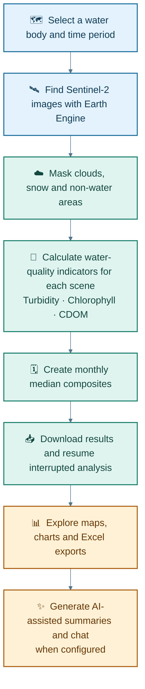

# 🛰️ WaterAgent

**Explore how water quality changes over time, from a map to a meaningful picture.**

WaterAgent is a Streamlit application that uses Sentinel-2 imagery and Google Earth Engine to monitor water bodies. Draw an area on the map, choose a time period, and explore monthly water-quality indicators, charts, and summaries. The current application interface is in Persian.

## 🌊 What you can do

- 🗺️ **Map a water body:** draw, save, and select a monitoring area.
- 🔬 **Explore three indicators:** turbidity (NDTI), chlorophyll (NDCI), and colored dissolved organic matter (CDOM).
- 📈 **Follow changes over time:** view monthly maps, charts, statistics, and data-coverage information.
- 🔄 **Pick up where you left off:** reopen saved local analyses and resume interrupted processing.
- 📊 **Share results:** export analysis results to Excel and use the AI-assisted summary and chat features when configured.

## 🛰️ From satellite imagery to insights



Sentinel-2 scenes are processed in Google Earth Engine, including cloud, snow, and water masking. The application calculates the indicators for each scene, builds monthly composites, and presents the results in an interactive dashboard. Satellite indicators are estimates and should be interpreted in context alongside suitable field measurements.

## 🚀 Getting started

You will need Python 3.12, access to Google Earth Engine, and the appropriate Google Cloud project and credentials. The project has been developed and tested in Ubuntu/WSL.

```bash
git clone https://github.com/opsai2025/WaterAgent.git
cd WaterAgent
python3 -m venv .venv
source .venv/bin/activate
python -m pip install -r requirements.lock.txt
cp -n .env.example .env
```

Configure the required settings in `.env`. Earth Engine can use existing Google credentials or a Base64-encoded service-account key in `GOOGLE_EARTH_ENGINE_KEY_BASE64`. AI and other external services require their own configuration when used. **Never commit `.env`, service-account keys, or other secrets.**

Create the first local administrator account and start the application:

```bash
python -m water_monitoring_app.auth bootstrap-admin
streamlit run water_monitoring.py --server.address 127.0.0.1
```

The administrator credentials are requested interactively. Then open `http://localhost:8501` in your browser.

## 🧭 Good to know

- Local accounts and analysis history are stored under `.water_monitor_data` by default; back them up together and keep them private.
- Large monitoring areas can exceed Earth Engine's direct download limit; automatic tiling is not yet implemented.
- `cloud_preview` is a temporary preview, not durable Supabase storage. Production deployment and persistent cloud storage require further work; see [deployment notes](DEPLOY_POSIT_SUPABASE.md).
- The project is under active development. For implementation details and current work, see [the redesign handoff](REDESIGN_HANDOFF.md) and [the original detailed README in Persian](README.fa.md). The Persian notes refer to a local design document that is not included in this repository.

## 🗂️ Project layout

| Path | Purpose |
| --- | --- |
| `water_monitoring.py` | Streamlit application entry point |
| `water_monitoring_app/` | Interface, satellite processing, analysis, accounts, and recovery |
| `tests/` | Automated tests |
| `supabase/migrations/` | Versioned database migration |

Run the test suite from the activated environment with `python -m unittest discover -s tests`.
